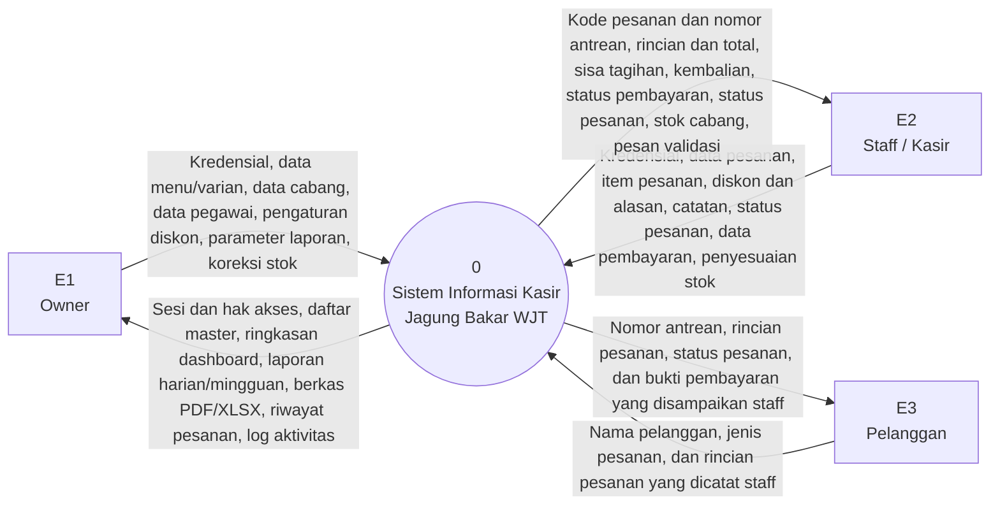
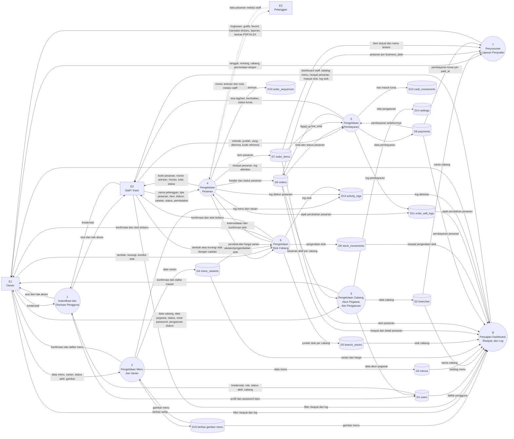
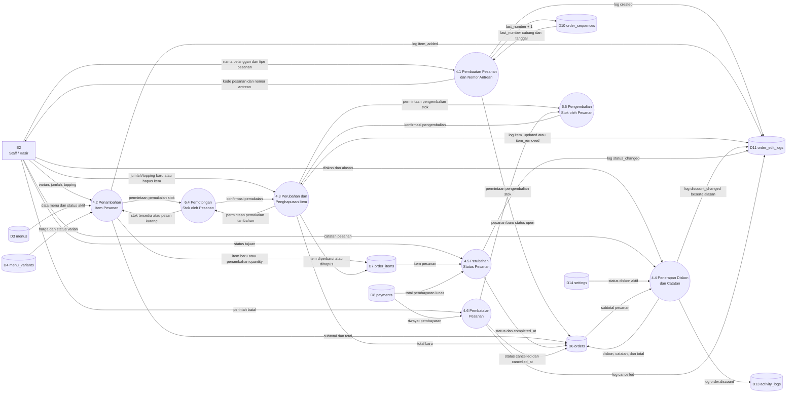
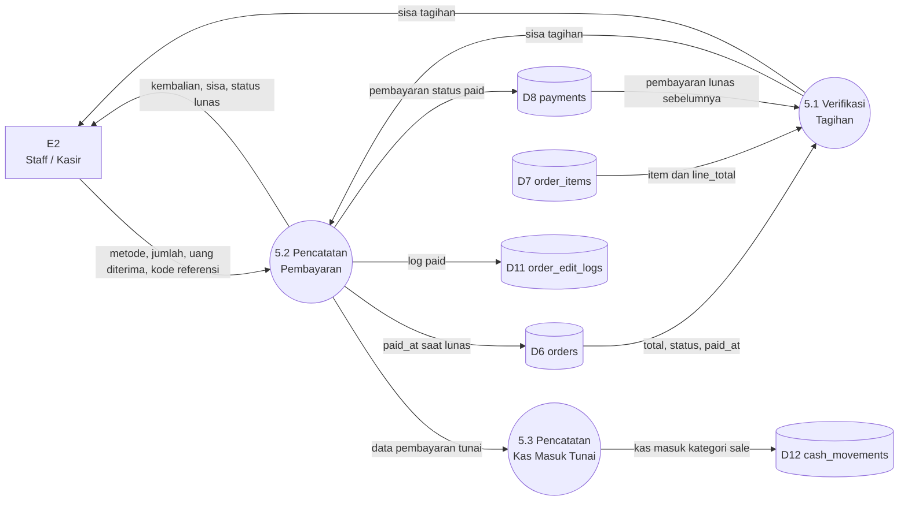
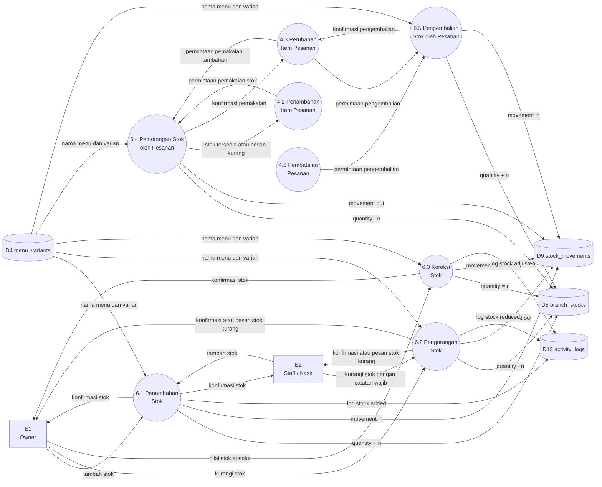
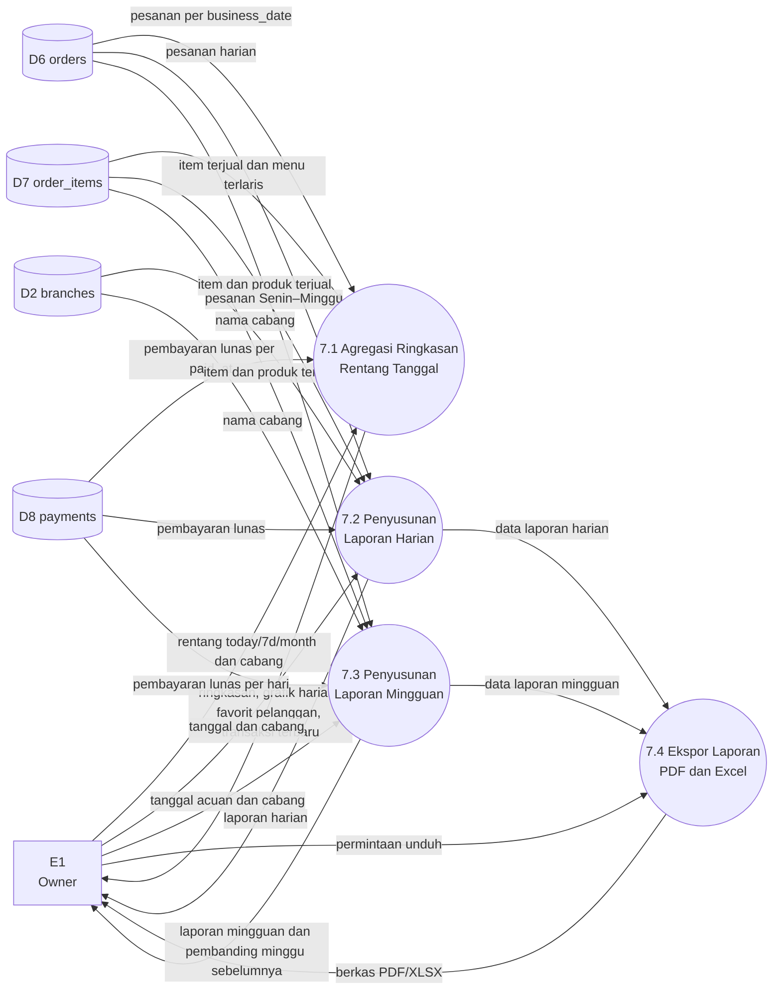

# Dokumentasi DFD — Sistem Informasi Kasir Jagung Bakar WJT

Dokumen ini disusun dari implementasi backend yang sudah ada pada proyek ini
(`routes/web.php`, controller, model, migration, middleware, dan service).
Tidak ada proses, entitas, atau data store yang ditambahkan di luar yang benar-benar
dipakai oleh kode aplikasi.

---

## 1. Deskripsi Sistem

**Jagung Bakar WJT** adalah aplikasi kasir (point of sale) berbasis web untuk
warung makanan dengan beberapa cabang. Sistem menangani:

1. Login pegawai dan pembatasan hak akses berdasarkan peran **owner** dan **staff**.
2. Pengelolaan data master: cabang, menu beserta varian, akun pegawai, dan
   pengaturan diskon kasir.
3. Pencatatan pesanan pelanggan di kasir, termasuk nomor antrean harian per cabang,
   penambahan/pengubahan/penghapusan item, diskon, catatan, perubahan status, dan
   pembatalan.
4. Pencatatan pembayaran (tunai, QRIS, transfer), perhitungan kembalian, serta
   pencatatan kas masuk untuk pembayaran tunai.
5. Pengelolaan stok per cabang per varian menu, baik penyesuaian manual maupun
   pemotongan/pengembalian otomatis akibat pesanan.
6. Penyusunan ringkasan dashboard, laporan harian, laporan mingguan, dan ekspor
   laporan ke PDF/Excel.
7. Penyajian riwayat pesanan, riwayat pergerakan stok, dan log aktivitas.

Batasan peran yang berlaku pada implementasi:

- **Owner** dapat mengakses seluruh cabang, mengelola menu, cabang, akun pegawai,
  pengaturan, stok (tambah/kurangi/koreksi), serta melihat laporan, riwayat pesanan,
  dan log aktivitas. Owner **tidak** dapat mengubah pesanan atau pembayaran
  (hanya baca).
- **Staff** hanya dapat mengakses pesanan dan stok cabangnya sendiri (katalog menu
  bersifat global), membuat dan memproses pesanan, menerima pembayaran, serta
  menambah/mengurangi stok dengan catatan wajib saat mengurangi stok. Staff tidak
  dapat mengoreksi stok secara absolut.
- Tidak ada registrasi publik. Akun pegawai hanya dibuat oleh owner.

---

## 2. Entitas Eksternal

| Kode | Entitas | Peran terhadap sistem | Data yang diberikan | Data yang diterima |
|---|---|---|---|---|
| **E1** | **Owner** | Pemilik warung; pengelola data master dan penerima laporan | Kredensial login; data menu dan varian; data cabang; data akun pegawai; pengaturan diskon; parameter filter laporan; data koreksi stok; data profil/password | Konfirmasi login; daftar menu/varian; daftar cabang; daftar pegawai; ringkasan dashboard; laporan harian/mingguan; berkas PDF/XLSX; riwayat pesanan; log aktivitas; konfirmasi stok |
| **E2** | **Staff / Kasir** | Pegawai cabang; operator transaksi harian | Kredensial login; nama pelanggan dan tipe pesanan; item pesanan (varian, jumlah, topping); diskon dan alasan; catatan pesanan; status pesanan; data pembayaran; penyesuaian stok dan catatan; filter daftar pesanan | Konfirmasi login; kode pesanan dan nomor antrean; rincian dan total pesanan; sisa tagihan; kembalian; status pembayaran; status pesanan; stok cabang; pesan validasi (stok kurang, pesanan bukan cabangnya); riwayat stok |
| **E3** | **Pelanggan** | Pemberi data pesanan pada saat transaksi | Nama pelanggan, jenis pesanan (dine-in/bawa pulang), dan rincian pesanan | Nomor antrean, rincian pesanan, status pesanan, dan bukti pembayaran |

Catatan: pelanggan tidak berinteraksi langsung dengan antarmuka sistem. Data
pelanggan dimasukkan oleh staff, dan nomor antrean/nota disampaikan kembali oleh
staff. Hubungan E3 pada DFD ini karena itu bersifat **transaksi bisnis**, bukan
akses aplikasi langsung (lihat bagian 10).

---

## 3. Daftar Proses

### 3.1 Level 0

| Kode | Proses | Keterangan |
|---|---|---|
| **0** | **Sistem Informasi Kasir Jagung Bakar WJT** | Seluruh sistem digambarkan sebagai satu proses tunggal yang menerima data dari Owner, Staff, dan Pelanggan, lalu menghasilkan informasi bagi ketiganya. |

### 3.2 Level 1

| Kode | Proses | Aktor utama | Data store utama | Diuraikan ke Level 2 |
|---|---|---|---|---|
| **1** | Autentikasi dan Otorisasi Pengguna | Owner, Staff | `users` | Tidak |
| **2** | Pengelolaan Menu dan Varian | Owner | `menus`, `menu_variants`, `activity_logs`, berkas gambar | Tidak |
| **3** | Pengelolaan Cabang, Akun Pegawai, dan Pengaturan | Owner | `branches`, `users`, `settings`, `orders` | Tidak |
| **4** | Pengelolaan Pesanan | Staff | `orders`, `order_items`, `order_sequences`, `order_edit_logs`, `activity_logs` | **Ya** (4.1–4.6) |
| **5** | Pengelolaan Pembayaran | Staff | `payments`, `orders`, `cash_movements`, `order_edit_logs` | **Ya** (5.1–5.3) |
| **6** | Pengelolaan Stok Cabang | Owner, Staff | `branch_stocks`, `stock_movements`, `activity_logs` | **Ya** (6.1–6.5) |
| **7** | Penyusunan Laporan Penjualan | Owner | `orders`, `order_items`, `payments`, `branches` | **Ya** (7.1–7.4) |
| **8** | Penyajian Dashboard, Riwayat, dan Log | Owner, Staff | `orders`, `order_items`, `payments`, `branch_stocks`, `menus`, `menu_variants`, `stock_movements`, `order_edit_logs`, `activity_logs`, `users` | Tidak |

Proses 1, 2, 3, dan 8 sengaja tidak diuraikan ke Level 2 karena alurnya sudah
cukup jelas pada Level 1 dan bukan prioritas transaksi. Level 2 difokuskan pada
pesanan, pembayaran, stok, dan laporan sesuai kebutuhan dokumentasi.

---

## 4. Daftar Data Store

Seluruh data store di bawah ini adalah tabel yang benar-benar ada pada migration
dan dipakai oleh kode aplikasi, dengan satu pengecualian: **D15** adalah
penyimpanan berkas gambar menu, bukan tabel database.

| Kode | Tabel | Field kunci | Fungsi | Ditulis oleh | Dibaca oleh |
|---|---|---|---|---|---|
| **D1** | `users` | `id`, `branch_id`, `name`, `email`, `phone`, `address`, `password_hash`, `role`, `is_active` | Akun owner dan staff beserta cabang dan status aktifnya | P1 (profil/password), P3 (CRUD staff) | P1, P3, P8 |
| **D2** | `branches` | `id`, `name`, `address`, `phone`, `is_active` | Data cabang warung | P3 | P3, P7, P8 |
| **D3** | `menus` | `id`, `name`, `description`, `category`, `is_active`, `image_path`, `thumb_path` | Menu (makanan/minuman/cemilan) | P2 | P2, P4, P8 |
| **D4** | `menu_variants` | `id`, `menu_id`, `type`, `variant_name`, `sku`, `selling_price`, `is_active` | Varian menu beserta harga jual | P2 | P2, P4, P6, P8 |
| **D5** | `branch_stocks` | `id`, `branch_id`, `menu_variant_id`, `quantity` | Stok varian per cabang | P6 | P4 (lewat P6), P6, P8 |
| **D6** | `orders` | `id`, `order_code`, `queue_number`, `business_date`, `customer_name`, `order_type`, `branch_id`, `created_by`, `status`, `subtotal`, `discount_amount`, `total_amount`, `notes`, `paid_at`, `completed_at`, `cancelled_at` | Header pesanan dan statusnya | P4, P5 | P3, P4, P5, P7, P8 |
| **D7** | `order_items` | `id`, `order_id`, `menu_variant_id`, `product_name_snapshot`, `variant_name_snapshot`, `topping_price`, `unit_price`, `quantity`, `is_addon`, `line_total` | Rincian item pesanan beserta harga saat transaksi | P4 | P4, P5, P7, P8 |
| **D8** | `payments` | `id`, `order_id`, `received_by`, `payment_method`, `amount`, `amount_tendered`, `change_amount`, `status`, `reference_code`, `paid_at` | Pembayaran yang diterima atas pesanan | P5 | P4, P5, P7, P8 |
| **D9** | `stock_movements` | `id`, `branch_id`, `menu_variant_id`, `user_id`, `movement_type`, `quantity`, `note`, `occurred_at` | Buku besar pergerakan stok (masuk, keluar, koreksi) | P6 | P8 |
| **D10** | `order_sequences` | `id`, `branch_id`, `business_date`, `last_number` | Penomoran antrean harian per cabang | P4 | P4 |
| **D11** | `order_edit_logs` | `id`, `order_id`, `user_id`, `action_type`, `before_data`, `after_data`, `reason` | Jejak perubahan pesanan (buat, item, diskon, status, bayar, batal) | P4, P5 | P8 |
| **D12** | `cash_movements` | `id`, `branch_id`, `user_id`, `movement_type`, `category`, `amount`, `description`, `related_payment_id`, `occurred_at` | Penerimaan kas tunai dari penjualan | P5 | — (belum ada proses pembaca) |
| **D13** | `activity_logs` | `id`, `user_id`, `branch_id`, `action`, `subject_type`, `subject_id`, `subject_label`, `description`, `changes`, `ip_address`, `created_at` | Log aktivitas owner/staff untuk menu, varian, stok, dan diskon | P2, P4, P6 | P8 |
| **D14** | `settings` | `id`, `key`, `value` | Pengaturan aplikasi, saat ini `pos.discounts_enabled` | P3 | P4 |
| **D15** | Berkas gambar menu | `menus/{uuid}.webp`, `menus/{uuid}-thumb.webp` pada disk `local` | Foto dan thumbnail menu hasil konversi WebP | P2 | P2 (lewat route media), P8 |

Catatan:

- `D15` adalah data store berkas, bukan tabel database. Path-nya disimpan di
  `menus.image_path` dan `menus.thumb_path`.
- Tabel framework `sessions`, `cache`, `cache_locks`, `jobs`, `job_batches`, dan
  `failed_jobs` tidak dimasukkan karena bukan data bisnis. `sessions` hanya dipakai
  Laravel untuk menyimpan sesi login.
- Tabel `stocks` (polimorfik) ada di database dan diisi seeder, tetapi **tidak
  dipakai** oleh alur aplikasi. Karena itu tabel ini tidak dijadikan data store DFD
  (lihat bagian 10).

---

## 5. DFD Level 0 (Diagram Konteks)

Notasi yang dipakai mengikuti **Yourdon/DeMarco**:

- **Persegi** = entitas eksternal.
- **Lingkaran** = proses.
- **Silinder** = data store (Mermaid tidak memiliki bentuk paralel garis, sehingga
  silinder dipakai sebagai pengganti visual).
- **Panah** = aliran data, bukan aliran kontrol atau urutan aktivitas.

Diagram hanya menggambarkan data yang masuk, keluar, dan disimpan. Urutan langkah
tidak digambarkan dengan panah, sehingga diagram ini bukan flowchart atau UML
Activity Diagram.

### 5.1 Diagram

### 5.2 Penjelasan

- Proses **0** mewakili seluruh aplikasi. Semua aliran data dari dan ke tiga entitas
  eksternal diringkas pada diagram ini.
- **Owner** adalah satu-satunya entitas yang mengelola data master dan menerima
  laporan. Owner juga dapat melakukan koreksi stok, tetapi tidak dapat mengubah
  transaksi.
- **Staff** adalah operator transaksi. Semua data pesanan, pembayaran, dan
  penyesuaian stok operasional berasal dari staff cabang yang bersangkutan.
- **Pelanggan** menyediakan data pesanan dan menerima nomor antrean/nota. Interaksi
  ini dimediasi staff, sehingga tidak ada antarmuka pelanggan di dalam sistem.
- Aliran data pada Level 0 harus sama dengan gabungan aliran Level 1. Pemeriksaan
  kesesuaiannya ada pada bagian 9.

---

## 6. DFD Level 1

### 6.1 Diagram

Garis putus-putus untuk E3 menandakan aliran bisnis yang tidak melalui antarmuka
langsung, karena seluruh input tetap dilakukan oleh staff.

### 6.2 Penjelasan Proses Level 1

#### P1 — Autentikasi dan Otorisasi Pengguna

- **Input:** email dan password dari E1/E2.
- **Proses:** memeriksa `users.email`, `password_hash`, dan `is_active`; membuat sesi;
  menentukan halaman awal berdasarkan `role` (`owner` → dashboard owner,
  `staff` → dashboard staff). Middleware `role:owner` dan `role:staff` menolak akses
  lintas peran dengan HTTP 403.
- **Output:** sesi login, hak akses sesuai peran, dan pembaruan profil/password pada
  `users` melalui halaman akun.
- **Data store:** D1.
- **Catatan implementasi:** akun nonaktif tidak bisa login dan mendapat pesan
  "Akun kamu belum aktif. Hubungi owner untuk mengaktifkannya." Tidak ada
  registrasi publik dan tidak ada fitur "Ingat saya".

#### P2 — Pengelolaan Menu dan Varian

- **Input:** nama, deskripsi, kategori (`makanan`/`minuman`/`cemilan`), status aktif,
  gambar, serta data varian (nama, tipe, harga, status) dari owner.
- **Proses:** membuat menu beserta satu varian awal; mengubah menu/varian;
  mengaktifkan atau menonaktifkan menu/varian (tidak ada penghapusan permanen);
  memproses gambar menjadi WebP penuh dan thumbnail; menulis log aktivitas.
- **Output:** daftar menu dan varian terbaru, gambar menu, dan log perubahan.
- **Data store:** D3, D4, D13, D15.
- **Catatan implementasi:** kategori `cemilan` ditampilkan sebagai **Hotmad** di UI.
  Harga topping hanya berlaku untuk kategori `makanan` dan dibaca dari
  `config/menu.php` (default Rp2.000).

#### P3 — Pengelolaan Cabang, Akun Pegawai, dan Pengaturan

- **Input:** data cabang (nama, alamat, telepon), data pegawai (nama, email, telepon,
  alamat, password, cabang), perintah aktif/nonaktif, reset password, dan nilai
  pengaturan diskon dari owner.
- **Proses:** CRUD cabang tanpa hapus; CRUD akun staff tanpa hapus; validasi
  penonaktifan cabang (ditolak bila masih ada staff aktif atau pesanan berjalan);
  reset password staff; menyimpan `pos.discounts_enabled`.
- **Output:** daftar cabang/pegawai terbaru, konfirmasi, dan status pengaturan.
- **Data store:** D1, D2, D14; membaca D6 untuk validasi penonaktifan cabang.
- **Catatan implementasi:** menonaktifkan staff tidak menghapus `branch_id`, tetapi
  login langsung ditolak karena `is_active = false`. Saat mengaktifkan kembali,
  owner wajib memilih cabang.

#### P4 — Pengelolaan Pesanan

- **Input:** nama pelanggan, tipe pesanan (`dine_in`/`takeaway`), item (varian,
  jumlah, topping), diskon dan alasan, catatan, status tujuan, dan perintah batal
  dari staff.
- **Proses:** membuat pesanan dan nomor antrean; menambah/mengubah/menghapus item;
  menghitung ulang subtotal, diskon, dan total; menerapkan diskon bila diaktifkan;
  mengubah status; membatalkan pesanan; menulis jejak perubahan.
- **Output:** kode pesanan, nomor antrean, rincian dan total terbaru, status pesanan,
  serta pesan validasi (misalnya stok kurang atau pesanan milik cabang lain).
- **Data store:** D6, D7, D10, D11, D13; membaca D3, D4, D8, D14; berkoordinasi
  dengan P6 untuk stok.
- **Status pesanan:** `open → processing → ready → completed`, dengan `cancelled`
  sebagai jalan keluar. Pesanan hanya bisa diselesaikan bila sudah lunas, dan hanya
  bisa dibatalkan bila belum ada pembayaran.
- **Catatan implementasi:** nomor antrean dialokasikan per cabang dan
  `business_date`; nomor yang sudah terpakai tidak pernah dipakai ulang, termasuk
  setelah pesanan dibatalkan.

#### P5 — Pengelolaan Pembayaran

- **Input:** metode pembayaran (`cash`/`qris`/`transfer`), jumlah bayar, uang diterima
  (khusus tunai), dan kode referensi opsional dari staff.
- **Proses:** memverifikasi pesanan masih aktif dan memiliki item; menghitung sisa
  tagihan dari total pesanan dikurangi pembayaran lunas; memvalidasi jumlah bayar
  tidak melebihi sisa tagihan; menghitung kembalian untuk tunai; menyimpan
  pembayaran berstatus `paid`; menandai `paid_at` saat lunas; mencatat kas masuk
  untuk pembayaran tunai.
- **Output:** konfirmasi pembayaran, kembalian, sisa tagihan, dan status lunas.
- **Data store:** D8, D6, D11, D12; membaca D7 dan D8.
- **Catatan implementasi:** pembayaran boleh dilakukan bertahap (cicilan) selama
  pesanan masih aktif. Status `pending`, `failed`, dan `refunded` ada pada struktur
  tabel, tetapi alur aplikasi saat ini selalu menulis `paid`.

#### P6 — Pengelolaan Stok Cabang

- **Input:** varian, mode penyesuaian (tambah/kurangi/koreksi), jumlah, dan catatan
  dari owner/staff; serta permintaan pemotongan/pengembalian dari P4.
- **Proses:** menambah stok, mengurangi stok (catatan wajib untuk staff), mengoreksi
  stok secara absolut (khusus owner), memotong stok saat item pesanan ditambahkan,
  dan mengembalikan stok saat item dihapus/dikurangi atau pesanan dibatalkan.
- **Output:** jumlah stok terbaru, konfirmasi, pesan stok tidak cukup, dan riwayat
  pergerakan stok.
- **Data store:** D5, D9, D13; membaca D4.
- **Catatan implementasi:** pemotongan/pengembalian otomatis oleh pesanan hanya
  menulis `stock_movements`, tidak menulis `activity_logs`. Log aktivitas stok hanya
  ditulis untuk penyesuaian manual (tambah/kurangi/koreksi).

#### P7 — Penyusunan Laporan Penjualan

- **Input:** tanggal, rentang (`today`/`7d`/`month`), cabang, dan permintaan ekspor
  dari owner.
- **Proses:** menghitung pendapatan dari pembayaran lunas berdasarkan `paid_at`;
  menghitung jumlah pesanan dan item terjual berdasarkan `business_date` dengan
  mengecualikan pesanan batal; menyusun grafik harian, menu terlaris, transaksi
  terbaru, laporan harian, laporan mingguan, serta berkas PDF/Excel.
- **Output:** ringkasan dashboard owner, laporan harian/mingguan, dan berkas unduhan.
- **Data store:** membaca D2, D6, D7, D8.
- **Catatan implementasi:** karena pendapatan dihitung dari pembayaran dan jumlah
  pesanan dihitung dari tanggal usaha, kedua angka dapat berbeda pada periode yang
  sama. Laporan mingguan memakai rentang Senin–Minggu.

#### P8 — Penyajian Dashboard, Riwayat, dan Log

- **Input:** filter status, cabang, tanggal, pencarian, pengguna, dan rentang tanggal
  dari owner/staff.
- **Proses:** menyajikan dashboard staff (pendapatan hari ini, jumlah pesanan aktif,
  total stok, katalog menu, lima pesanan terbaru), riwayat pesanan owner (baca saja),
  riwayat pesanan staff cabang sendiri, detail pesanan, riwayat pergerakan stok, dan
  log aktivitas.
- **Output:** daftar dan detail informasi sesuai peran.
- **Data store:** membaca D1, D3, D4, D5, D6, D7, D8, D9, D11, D13.
- **Catatan implementasi:** staff hanya melihat data cabangnya; owner melihat semua
  cabang. Owner tidak memiliki aksi ubah/hapus pada halaman pesanan.

---

## 7. DFD Level 2

Level 2 hanya menguraikan proses prioritas: **4 (Pesanan)**, **5 (Pembayaran)**,
**6 (Stok)**, dan **7 (Laporan)**. Penomoran subproses mengikuti nomor proses
induknya.

### 7.1 Proses 4 — Pengelolaan Pesanan

#### 7.1.1 Diagram

#### 7.1.2 Penjelasan Subproses

**4.1 Pembuatan Pesanan dan Nomor Antrean**
- Staff memasukkan nama pelanggan dan tipe pesanan.
- Sistem memastikan akun staff memiliki `branch_id`, lalu mengambil nomor urut
  terakhir pada `order_sequences` untuk cabang dan tanggal usaha tersebut.
- Nomor berikutnya (`last_number + 1`) disimpan, lalu pesanan dibuat dengan
  `order_code` format `WJT-{branch_id}-{YYYYMMDD}-{queue}` dan status `open`.
- Log `created` ditulis ke `order_edit_logs`.
- Output: kode pesanan dan nomor antrean ke staff.

**4.2 Penambahan Item Pesanan**
- Input: varian, jumlah (1–99), dan opsi topping.
- Sistem memeriksa menu dan varian masih aktif, mengambil harga jual, dan
  menghitung harga topping hanya untuk menu `makanan`.
- Jika pesanan belum memiliki pembayaran, item dengan varian dan topping yang sama
  akan digabung quantity-nya. Jika sudah ada pembayaran, item baru ditandai
  `is_addon = true`, dan pesanan yang berstatus `ready` dikembalikan ke `processing`.
- Sistem meminta P6 memotong stok. Bila stok tidak cukup, item tidak disimpan dan
  staff menerima pesan kesalahan.
- Subtotal, diskon, dan total dihitung ulang; log `item_added` ditulis.

**4.3 Perubahan dan Penghapusan Item**
- Perubahan quantity memakai selisih: penambahan memotong stok, pengurangan
  mengembalikan stok.
- Penghapusan item mengembalikan seluruh quantity ke stok, menghapus baris
  `order_items`, lalu menghitung ulang total.
- Hanya berlaku untuk pesanan `open` yang belum memiliki pembayaran.
- Log `item_updated` atau `item_removed` ditulis.

**4.4 Penerapan Diskon dan Catatan**
- Diskon hanya dapat diterapkan bila `pos.discounts_enabled` bernilai aktif dan
  pesanan masih `open` serta belum dibayar.
- Diskon tidak boleh melebihi subtotal. Nilai diskon, total, dan alasan disimpan.
- Perubahan diskon menulis dua log: `order_edit_logs` (`discount_changed` beserta
  alasan) dan `activity_logs` (`order.discount`) agar terlihat pada log aktivitas.
- Catatan pesanan dapat diubah selama pesanan masih aktif, termasuk setelah dibayar.
- Log catatan memakai tipe `other` pada `order_edit_logs`.

**4.5 Perubahan Status Pesanan**
- Transisi yang diizinkan:
  - `open`/`ready` → `processing`
  - `open`/`processing` → `ready`
  - `open`/`processing`/`ready` → `completed`, hanya bila total pembayaran lunas.
- Status `completed` mengisi `completed_at`. Pesanan `completed` atau `cancelled`
  tidak dapat diubah lagi.
- Log `status_changed` ditulis.

**4.6 Pembatalan Pesanan**
- Hanya pesanan aktif yang **belum memiliki pembayaran** yang dapat dibatalkan.
- Seluruh item dikembalikan ke stok melalui 6.5.
- Status diubah menjadi `cancelled` dan `cancelled_at` diisi.
- Log `cancelled` ditulis. Nomor antrean tetap terpakai dan tidak dikembalikan.

### 7.2 Proses 5 — Pengelolaan Pembayaran

#### 7.2.1 Diagram

#### 7.2.2 Penjelasan Subproses

**5.1 Verifikasi Tagihan**
- Membaca total pesanan dari `orders`, item dari `order_items`, dan seluruh
  pembayaran berstatus `paid`.
- Menghitung `balanceDue = max(0, total_amount - paidAmount)`.
- Menolak pembayaran bila pesanan sudah selesai/batal, tidak memiliki item, atau
  sudah lunas.

**5.2 Pencatatan Pembayaran**
- Input: metode (`cash`/`qris`/`transfer`), jumlah, uang diterima (wajib untuk
  tunai), dan kode referensi opsional.
- Jumlah pembayaran harus > 0 dan tidak boleh melebihi sisa tagihan.
- Untuk tunai, uang diterima tidak boleh kurang dari jumlah pembayaran; kembalian
  dihitung dari selisihnya.
- Sistem menyimpan baris `payments` dengan status `paid`, `received_by`, dan
  `paid_at`, lalu mengisi `orders.paid_at` bila pembayaran membuat pesanan lunas.
- Log `paid` ditulis ke `order_edit_logs`.
- Output ke staff: konfirmasi, kembalian, dan sisa tagihan.

**5.3 Pencatatan Kas Masuk Tunai**
- Hanya dipicu oleh pembayaran metode `cash`.
- Menulis `cash_movements` dengan `movement_type = in`,
  `category = sale`, `related_payment_id`, dan deskripsi nomor antrean/kode pesanan.
- Pembayaran QRIS dan transfer tidak menulis `cash_movements`.

### 7.3 Proses 6 — Pengelolaan Stok Cabang

#### 7.3.1 Diagram

#### 7.3.2 Penjelasan Subproses

**6.1 Penambahan Stok**
- Owner atau staff memilih varian dan jumlah.
- Sistem mencari baris `branch_stocks` cabang tersebut; bila belum ada, dibuat
  dengan quantity 0.
- Quantity ditambah, lalu `stock_movements` bertipe `in` dan log `stock.added`
  ditulis.

**6.2 Pengurangan Stok**
- Owner atau staff mengurangi stok. Untuk staff, catatan **wajib** diisi.
- Sistem menolak bila hasil pengurangan < 0.
- Quantity dikurangi, lalu `stock_movements` bertipe `out` dan log `stock.reduced`
  ditulis.

**6.3 Koreksi Stok**
- Hanya owner yang dapat mengoreksi stok secara absolut (menu "Koreksi").
- Nilai quantity diganti langsung, bukan ditambah/dikurangi.
- Bila nilai baru sama dengan nilai lama, tidak ada perubahan yang dicatat.
- `stock_movements` bertipe `adjustment` dan log `stock.adjusted` ditulis.

**6.4 Pemotongan Stok oleh Pesanan**
- Dipicu oleh 4.2 (item baru) dan 4.3 (penambahan quantity).
- Sistem mengunci baris stok, memeriksa ketersediaan, lalu mengurangi quantity.
- Bila stok tidak cukup, transaksi pesanan dibatalkan dan staff menerima pesan
  "Stok tidak cukup ... Tambah stok terlebih dahulu."
- Hanya menulis `stock_movements` bertipe `out` dengan catatan nomor antrean/menu;
  tidak menulis `activity_logs`.

**6.5 Pengembalian Stok oleh Pesanan**
- Dipicu oleh 4.3 (pengurangan quantity/penghapusan item) dan 4.6 (pembatalan).
- Quantity dikembalikan, lalu `stock_movements` bertipe `in` ditulis.
- Bila baris stok belum ada, dibuat terlebih dahulu.
- Tidak menulis `activity_logs`.

### 7.4 Proses 7 — Penyusunan Laporan Penjualan

#### 7.4.1 Diagram

#### 7.4.2 Penjelasan Subproses

**7.1 Agregasi Ringkasan Rentang Tanggal**
- Tiga preset: `today`, `7d` (default), dan `month`.
- Pendapatan dihitung dari `payments` berstatus `paid` berdasarkan `paid_at`.
- Jumlah pesanan, item terjual, menu terlaris, dan transaksi terbaru dihitung dari
  `orders`/`order_items` berdasarkan `business_date`, mengecualikan pesanan batal.
- Menu terlaris digabung per `product_name_snapshot` sehingga varian tidak memecah
  baris.
- Pembanding dihitung dari rentang sebelumnya (kemarin, 7 hari sebelumnya, atau
  bulan lalu sampai tanggal yang sama).
- Cabang yang tidak valid pada query string diabaikan sehingga dashboard menampilkan
  semua cabang.

**7.2 Penyusunan Laporan Harian**
- Mengambil pesanan pada satu `business_date` dan pembayaran lunas pada hari itu.
- Menghasilkan ringkasan (total pesanan, selesai, aktif, batal, penjualan kotor,
  diskon, pendapatan, pesanan terbayar, rata-rata, sisa tagihan), rekap metode
  pembayaran, daftar pesanan, dan produk terjual.
- Owner dapat mengunduh versi PDF dan Excel.

**7.3 Penyusunan Laporan Mingguan**
- Rentang Senin–Minggu yang memuat tanggal acuan.
- Menghasilkan rekap per hari, ringkasan mingguan, hari terbaik, rekap metode
  pembayaran, produk terjual, dan perbandingan dengan minggu sebelumnya.
- Owner dapat mengunduh versi PDF dan Excel.

**7.4 Ekspor Laporan PDF dan Excel**
- Menerima data laporan dari 7.2 atau 7.3.
- Membuat berkas PDF (DomPDF) atau XLSX, lalu mengirimkannya sebagai unduhan.
- Nama berkas memuat tanggal/rentang dan nama cabang bila cabang dipilih.

---

## 8. Penjelasan Aliran Data

### 8.1 Aliran dari Owner (E1)

| Aliran | Tujuan | Isi | Proses |
|---|---|---|---|
| Kredensial login | P1 | Email dan password | P1 |
| Data menu/varian | P2 | Nama, deskripsi, kategori, status, gambar, varian dan harga | P2 |
| Data cabang/pegawai/pengaturan | P3 | Profil cabang, akun staff, status aktif, reset password, diskon aktif | P3 |
| Parameter laporan | P7 | Tanggal, rentang, cabang, permintaan ekspor | P7 |
| Filter pemantauan | P8 | Status, cabang, pengguna, tanggal, pencarian | P8 |
| Penyesuaian stok | P6 | Varian, mode, jumlah, catatan | P6 |

Keluaran balik ke owner: konfirmasi dan daftar master (P2/P3), ringkasan dashboard
dan laporan (P7), riwayat pesanan dan log aktivitas (P8), serta konfirmasi stok (P6).

### 8.2 Aliran dari Staff (E2)

| Aliran | Tujuan | Isi | Proses |
|---|---|---|---|
| Kredensial login | P1 | Email dan password | P1 |
| Data pesanan | P4 | Nama pelanggan, tipe pesanan | P4.1 |
| Item pesanan | P4 | Varian, jumlah, topping | P4.2/P4.3 |
| Diskon dan catatan | P4 | Nominal diskon, alasan, catatan | P4.4 |
| Status pesanan | P4 | `processing`/`ready`/`completed` | P4.5 |
| Pembatalan | P4 | Perintah batal | P4.6 |
| Data pembayaran | P5 | Metode, jumlah, uang diterima, referensi | P5.2 |
| Penyesuaian stok | P6 | Varian, tambah/kurangi, jumlah, catatan | P6.1/P6.2 |
| Filter daftar | P8 | Status, tanggal, pencarian | P8 |

Keluaran balik ke staff: kode pesanan dan nomor antrean, rincian/total, sisa tagihan,
kembalian, status pembayaran dan pesanan, stok cabang, serta pesan validasi.

### 8.3 Aliran Pelanggan (E3)

Pelanggan memberikan nama, jenis pesanan, dan rincian pesanan; data ini dicatat
staff pada P4.1 dan P4.2. Sistem mengembalikan nomor antrean, rincian pesanan,
status, dan bukti pembayaran melalui staff. Tidak ada aliran langsung antara
pelanggan dan antarmuka aplikasi.

### 8.4 Aliran Antara Proses

Aliran langsung antarproses pada DFD ini hanya terjadi antara **P4** dan **P6**:

| Dari | Ke | Data | Kapan |
|---|---|---|---|
| P4 | P6 | Permintaan pemakaian stok (varian, quantity, catatan) | Saat item ditambahkan atau quantity dinaikkan |
| P6 | P4 | Ketersediaan stok atau pesan stok kurang | Sebelum item disimpan |
| P4 | P6 | Permintaan pengembalian stok | Saat quantity diturunkan, item dihapus, atau pesanan dibatalkan |
| P6 | P4 | Konfirmasi pengembalian | Setelah stok dikembalikan |

Ketergantungan proses lain tidak berupa aliran langsung, melainkan melalui data
store:

- P4 membaca katalog menu/varian dari D3/D4 dan status diskon dari D14.
- P5 membaca total pesanan dari D6, item dari D7, dan pembayaran sebelumnya dari D8,
  lalu menulis D8 dan memperbarui D6.
- P7 membaca D2, D6, D7, dan D8.
- P8 membaca D1, D2, D3, D4, D5, D6, D7, D8, D9, D11, dan D13.

Pembayaran tidak mengubah stok, sehingga tidak ada aliran P5 → P6.

### 8.5 Aliran ke Data Store

- **P4** menulis `orders`, `order_items`, `order_sequences`, `order_edit_logs`, dan
  `activity_logs` (khusus diskon).
- **P5** menulis `payments`, `orders` (paid_at), `order_edit_logs`, dan
  `cash_movements` (khusus tunai).
- **P6** menulis `branch_stocks` dan `stock_movements`; menulis `activity_logs`
  hanya untuk penyesuaian manual.
- **P2** menulis `menus`, `menu_variants`, `activity_logs`, dan berkas gambar.
- **P3** menulis `branches`, `users`, dan `settings`.
- **P7** dan **P8** hanya membaca data store.

---

## 9. Pemeriksaan Konsistensi Antarlevel

### 9.1 Keseimbangan Level 0 ke Level 1

| Aliran Level 0 | Proses Level 1 yang menangani |
|---|---|
| Owner → kredensial | P1 |
| Owner → data menu/varian | P2 |
| Owner → data cabang/pegawai/pengaturan | P3 |
| Owner → parameter laporan/ekspor | P7 |
| Owner → koreksi stok | P6 |
| Owner → filter riwayat/log | P8 |
| Staff → kredensial | P1 |
| Staff → data pesanan/item/diskon/catatan/status/batal | P4 |
| Staff → data pembayaran | P5 |
| Staff → penyesuaian stok | P6 |
| Staff → filter riwayat/log | P8 |
| Pelanggan → data pesanan | P4 (dicatat staff) |
| Sistem → Owner: master, laporan, riwayat, log | P2, P3, P7, P8 |
| Sistem → Staff: pesanan, pembayaran, stok, validasi | P4, P5, P6, P8 |
| Sistem → Pelanggan: antrean, nota, status | P4, P5 (melalui staff) |

Tidak ada aliran Level 0 yang hilang, dan tidak ada proses Level 1 yang tidak
memiliki kaitan dengan aliran Level 0.

### 9.2 Keseimbangan Level 1 ke Level 2

| Proses Level 1 | Subproses Level 2 | Cakupan |
|---|---|---|
| P4 Pengelolaan Pesanan | 4.1, 4.2, 4.3, 4.4, 4.5, 4.6 | Seluruh aksi pesanan pada `OrderService` dan `Staff\OrderController` |
| P5 Pengelolaan Pembayaran | 5.1, 5.2, 5.3 | `addPayment`, verifikasi tagihan, dan `CashMovement` |
| P6 Pengelolaan Stok | 6.1, 6.2, 6.3, 6.4, 6.5 | `adjustStock`, `takeStock`, dan `returnStock` |
| P7 Penyusunan Laporan | 7.1, 7.2, 7.3, 7.4 | `buildRange`, `build`, `buildWeekly`, dan ekspor |

Proses 1, 2, 3, dan 8 tidak dipecah karena tidak termasuk prioritas Level 2.
Semua input/output proses induk tetap terwakili oleh subprosesnya:

- Input P4 (data pesanan, item, diskon, catatan, status, batal) muncul pada
  4.1–4.6; output P4 (nomor antrean, rincian, total, status) juga muncul pada
  subproses yang sama.
- Input P5 (data pembayaran) muncul pada 5.2; output P5 (kembalian, sisa, status
  lunas) muncul pada 5.1/5.2.
- Input P6 (penyesuaian manual dan permintaan dari P4) muncul pada 6.1–6.5; output
  P6 (stok terbaru, konfirmasi, pesan kurang) juga muncul.
- Input P7 (parameter laporan) muncul pada 7.1–7.3; output P7 (ringkasan, laporan,
  berkas) muncul pada 7.1–7.4.

### 9.3 Konsistensi Data Store

| Data store | Penulis | Pembaca | Status |
|---|---|---|---|
| D1 `users` | P1, P3 | P1, P3, P8 | Seimbang |
| D2 `branches` | P3 | P3, P7, P8 | Seimbang |
| D3 `menus` | P2 | P2, P4, P8 | Seimbang |
| D4 `menu_variants` | P2 | P2, P4, P6, P8 | Seimbang |
| D5 `branch_stocks` | P6 | P4 (via P6), P6, P8 | Seimbang |
| D6 `orders` | P4, P5 | P3, P4, P5, P7, P8 | Seimbang |
| D7 `order_items` | P4 | P4, P5, P7, P8 | Seimbang |
| D8 `payments` | P5 | P4, P5, P7, P8 | Seimbang |
| D9 `stock_movements` | P6 | P8 | Seimbang |
| D10 `order_sequences` | P4 | P4 | Seimbang |
| D11 `order_edit_logs` | P4, P5 | P8 | Seimbang |
| D12 `cash_movements` | P5 | — | Hanya penulis; belum ada halaman pembaca |
| D13 `activity_logs` | P2, P4, P6 | P8 | Seimbang |
| D14 `settings` | P3 | P4 | Seimbang |
| D15 berkas gambar | P2 | P2, P8 | Seimbang |

`D12` sengaja tetap dicantumkan karena tabel benar-benar ditulis oleh proses
pembayaran tunai, meskipun belum ada proses yang membacanya. Ini bukan proses
fiktif, melainkan data store dengan pembaca yang belum diimplementasikan.

### 9.4 Pemeriksaan Penomoran

- Level 0: proses `0`.
- Level 1: proses `1`–`8`.
- Level 2: subproses memakai nomor induk, yaitu `4.1`–`4.6`, `5.1`–`5.3`,
  `6.1`–`6.5`, dan `7.1`–`7.4`.
- Tidak ada nomor yang melompat atau dipakai ganda.
- Nama proses, entitas, dan data store konsisten di seluruh level.

### 9.5 Pemeriksaan Input/Output Logis

Setiap proses memiliki input dan output yang dapat dilacak ke kode:

- Tidak ada proses yang hanya menghasilkan data tanpa sumber input.
- Tidak ada proses yang hanya menerima data tanpa output.
- Setiap penulisan data store memiliki pembaca, kecuali `D12` yang dijelaskan di
  atas.
- Setiap aliran antarproses memiliki padanan pemanggilan service/controller yang
  nyata.

---

## 10. Catatan Keterbatasan dan Asumsi

### 10.1 Status Implementasi

| Kelompok fitur | Status | Keterangan |
|---|---|---|
| Login, logout, profil, ganti password | **Sudah** | P1 |
| Pengelolaan menu, varian, gambar menu, status aktif | **Sudah** | P2 |
| Pengelolaan cabang, akun pegawai, reset password, pengaturan diskon | **Sudah** | P3 |
| Pesanan, nomor antrean, item, topping, diskon, catatan, status, pembatalan | **Sudah** | P4 dan Level 2 4.1–4.6 |
| Pembayaran tunai/QRIS/transfer, pembayaran bertahap, kembalian, kas masuk tunai | **Sudah** | P5 dan Level 2 5.1–5.3 |
| Stok per cabang: tambah, kurang, koreksi, potong/kembalikan otomatis | **Sudah** | P6 dan Level 2 6.1–6.5 |
| Dashboard owner, laporan harian/mingguan, ekspor PDF/Excel | **Sudah** | P7 dan Level 2 7.1–7.4 |
| Dashboard staff, katalog menu staff, riwayat pesanan, riwayat stok, log aktivitas | **Sudah** | P8 |
| Pencatatan kas keluar, tarik modal, biaya operasional | **Belum direncanakan di kode** | Tabel `cash_movements` mendukung kategori, tetapi belum ada proses/UI yang menulis selain penjualan tunai |
| Alur pembayaran gagal, refund, atau pending | **Belum direncanakan di kode** | Enum `payments.status` mendukung, tetapi aplikasi selalu menulis `paid` |
| Registrasi publik / pemesanan mandiri pelanggan | **Tidak ada** | Akun hanya dibuat owner; pelanggan tidak mengakses aplikasi |
| Penghapusan permanen data master | **Tidak ada** | Diganti status aktif atau status `cancelled` |
| Penyempurnaan tampilan mobile-first dan halaman UI yang belum dibangun | **Sedang direncanakan** | Tidak menambah proses bisnis baru; tidak digambarkan sebagai proses DFD |

### 10.2 Asumsi dan Batasan Teknis

1. **Sumber kebenaran adalah kode backend.** DFD disusun dari route, controller,
   model, migration, middleware, dan service yang ada. Tampilan (Blade/CSS) tidak
   menambah proses bisnis baru.
2. **Pelanggan tidak mengakses aplikasi.** Seluruh input pelanggan dimasukkan staff.
   Aliran E3 pada Level 0 karena itu bersifat bisnis, bukan aliran antarmuka.
3. **Tabel `stocks` tidak dipakai.** Tabel polimorfik `stocks` ada di database dan
   diisi oleh `StocksSeeder`, tetapi tidak dibaca/ditulis oleh alur aplikasi. Stok
   yang benar-benar dipakai adalah `branch_stocks`. Tabel `stocks` karena itu tidak
   dijadikan data store DFD.
4. **Tabel framework tidak dimasukkan.** `sessions`, `cache`, `cache_locks`,
   `jobs`, `job_batches`, dan `failed_jobs` bukan data bisnis. `sessions` tetap
   dipakai untuk menyimpan sesi login pada P1.
5. **Sisa struktur lama.** Tabel `orders` masih memiliki kolom `finalized_by` dan
   `finalized_at`, serta enum status lama `draft`/`finalized`. Kode saat ini tidak
   menulis kolom tersebut dan memakai status `open`, `processing`, `ready`,
   `completed`, `cancelled`. Kolom `stock_movements.unit_cost` juga tidak pernah
   diisi. Kolom-kolom ini tidak digambarkan sebagai aliran aktif.
6. **Pembayaran bertahap.** Struktur `payments` mendukung banyak baris per pesanan.
   Alur aplikasi selalu menulis status `paid`, sehingga status `pending`, `failed`,
   dan `refunded` belum menjadi bagian dari proses aktif.
7. **Kas keluar belum ada.** `cash_movements` memiliki kategori
   `owner_withdrawal`, `operational_expense`, `cash_deposit`, `correction`, dan
   `other`, tetapi hanya kategori `sale` yang ditulis oleh aplikasi. Tidak ada
   proses pencatatan kas keluar pada implementasi saat ini.
8. **Laporan dan dashboard berbeda sumber hitung.** Pendapatan berasal dari
   pembayaran lunas (`paid_at`), sedangkan jumlah pesanan dan item terjual berasal
   dari `business_date`. Karena itu angka pendapatan dan jumlah pesanan dapat
   berbeda pada periode yang sama.
9. **Nomor antrean tidak pernah dipakai ulang.** Nomor dialokasikan saat pesanan
   dibuat dan `last_number` tetap bertambah walaupun pesanan kemudian dibatalkan.
   Satu pelanggan = satu pesanan merupakan aturan alur kerja, bukan constraint unik
   pada database.
10. **Topping bukan item terpisah.** Harga topping disimpan pada
    `order_items.topping_price` dan hanya berlaku untuk menu kategori `makanan`
    dengan nilai dari `config/menu.php` (default Rp2.000). Tidak ada proses
    penambahan topping sebagai baris tersendiri.
11. **Fitur yang direncanakan, bukan proses baru.** Pengembangan antarmuka
    mobile-first dan penyempurnaan halaman (Kasir, Riwayat Pesanan, Kelola Stok,
    Kelola Menu, Kelola Akun Pegawai, dashboard staff) belum selesai di sisi
    tampilan, tetapi tidak menambah proses bisnis baru. DFD ini hanya memuat proses
    backend yang sudah berjalan.
12. **Otorisasi berbasis peran, bukan per-cabang penuh.** Owner dapat melihat semua
    cabang; staff dibatasi ke `branch_id` miliknya. Pengecekan cabang dilakukan di
    controller dan service, bukan pada level database.
13. **Gambar menu disimpan privat.** Berkas WebP disimpan pada disk `local`
    (`storage/app/private/menus`) dan diakses melalui route `media.menus.show` yang
    berada di dalam middleware `auth`, sehingga hanya pengguna login yang dapat
    membukanya.
14. **Tidak ada penghapusan permanen** untuk menu, varian, cabang, akun pegawai,
    dan pesanan. Penonaktifan dilakukan melalui kolom `is_active` (menu, varian,
    cabang, pengguna) atau status `cancelled` (pesanan).
